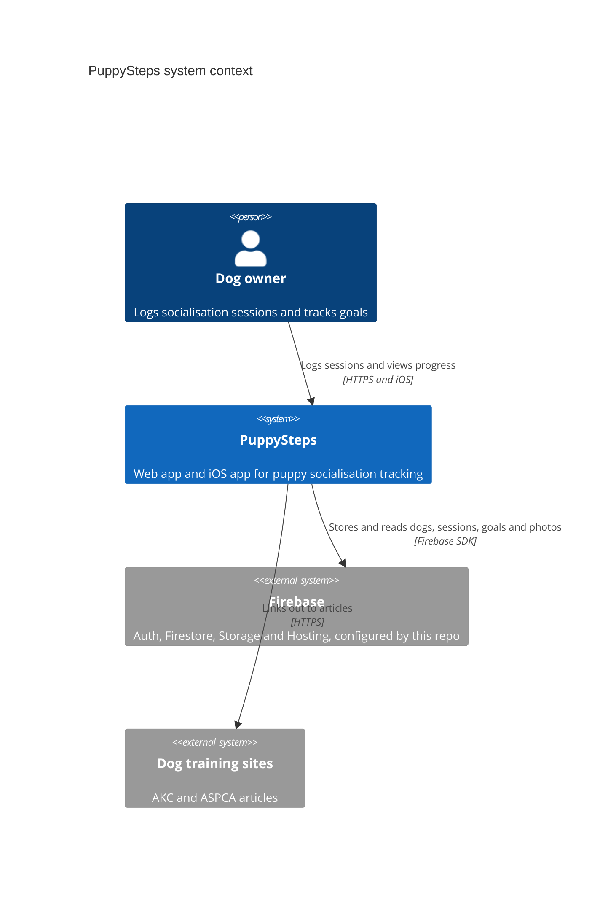
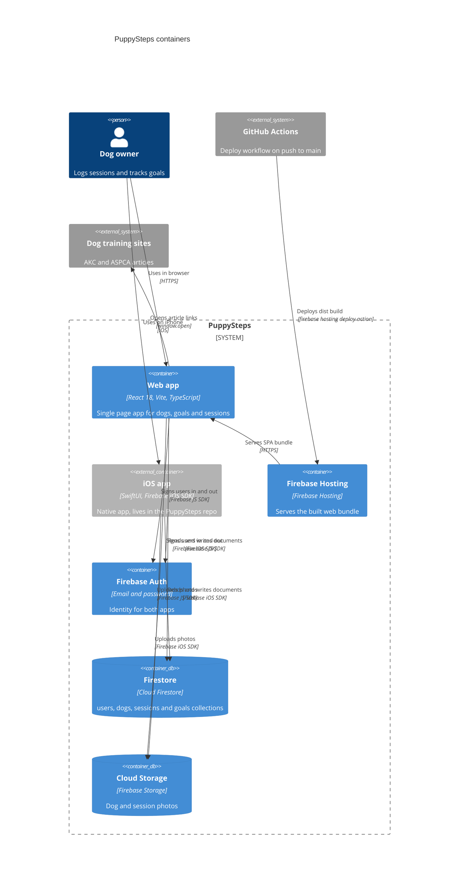
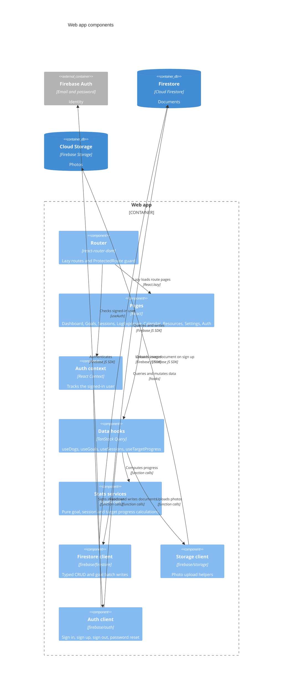

# Architecture

> Last verified: `54f6610` on `2026-11-17`

This repo is the **hub** for the PuppySteps system. It owns the Firebase configuration (`firebase.json`, `firestore.rules`, `storage.rules`, `.firebaserc`), so it owns the system's level 1 diagram. The sibling repo is the iOS app, [PuppySteps](https://github.com/NathanBellette/PuppySteps/blob/main/docs/architecture.md).

The backend in use per the code is **Firebase** (Auth, Firestore, Storage, Hosting). `docs/firebase-evaluation.md` and `docs/supabase-migration-plan.md` are planning documents for a possible move to Supabase. No Supabase client, config or migration exists in the code.

## System context (C4 level 1)

Owners use either the React web app or the SwiftUI iOS app. Both talk straight to Firebase from client code, and there is no custom API server. Firestore and Storage security rules in this repo are the only server-side enforcement.

## Containers (C4 level 2)

| Container | Tech | Where it lives |
|---|---|---|
| `puppysteps_web` | React 18, Vite 5, TypeScript, TanStack Query, React Router, Tailwind | `src/`, `index.html`, `vite.config.ts`, `package.json` |
| `puppysteps_ios` | SwiftUI, Firebase iOS SDK 12 | Other repo: [PuppySteps](https://github.com/NathanBellette/PuppySteps/blob/main/docs/architecture.md) |
| `puppysteps_hosting` | Firebase Hosting, SPA rewrite to `index.html` | `firebase.json` (`hosting`), `.firebaserc`, `.github/workflows/deploy.yml` |
| `puppysteps_firebase_auth` | Firebase Auth, email and password only | `src/lib/auth.ts`, `src/lib/firebase.ts` |
| `puppysteps_firestore` | Cloud Firestore, owner-only rules, deny by default | `firestore.rules`, `firebase.json` (`firestore`), `src/lib/firestore.ts` |
| `puppysteps_storage` | Firebase Storage, 5 MB image limit, owner-only paths `dogs/`, `sessions/`, `avatars/` | `storage.rules`, `firebase.json` (`storage`), `src/lib/storage.ts` |

Other build and test machinery: GitHub Actions run type check, lint, unit tests, build and Playwright (`.github/workflows/`). The `Dockerfile` is a CI-only Playwright test image, not a deployable. The Firebase project id and web config come from `VITE_FIREBASE_*` variables named in `env.example`.

## Components: Web app (C4 level 3)

| Component | Where it lives |
|---|---|
| Router | `src/routes/AppRouter.tsx`, `src/components/layout/ProtectedRoute.tsx` |
| Pages | `src/pages/` |
| Auth context | `src/context/AuthContext.tsx`, `src/hooks/useAuth.ts` |
| Data hooks | `src/hooks/useDogProfile.ts`, `useGoals.ts`, `useSessions.ts`, `useTargetProgress.ts` |
| Stats services | `src/services/goalStats.ts`, `sessionStats.ts`, `targetProgress.ts` |
| Firestore client | `src/lib/firestore.ts` (initialised in `src/lib/firebase.ts`) |
| Storage client | `src/lib/storage.ts` |
| Auth client | `src/lib/auth.ts` |

The web app reads with one-shot `getDocs` queries cached by TanStack Query (5 minute stale time, set in `src/App.tsx`). It does not use Firestore snapshot listeners.

## Cross-repo links

| This repo talks to | Container id | Repo | Architecture doc |
|---|---|---|---|
| iOS app (shares Firebase project, collections and rules with this repo) | `puppysteps_ios` | PuppySteps | [docs/architecture.md](https://github.com/NathanBellette/PuppySteps/blob/main/docs/architecture.md) |

This repo is the hub. The iOS repo draws its own level 2 and reuses the ids above (`puppysteps_firebase_auth`, `puppysteps_firestore`, `puppysteps_storage`) as `Container_Ext`.

## Detail

- Planning, not architecture: [firebase-evaluation.md](./firebase-evaluation.md) and [supabase-migration-plan.md](./supabase-migration-plan.md).
- Firestore collections with owner-only rules: `users` (document id is the uid), `dogs`, `sessions`, `goals` (each carries a `userId`). Anything else is denied.
- Storage paths allowed by `storage.rules`: `dogs/{userId}/...`, `sessions/{userId}/...`, `avatars/{userId}/...`. Images only, under 5 MB.
